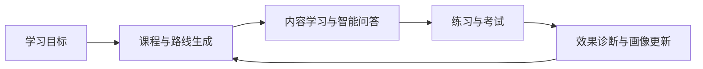
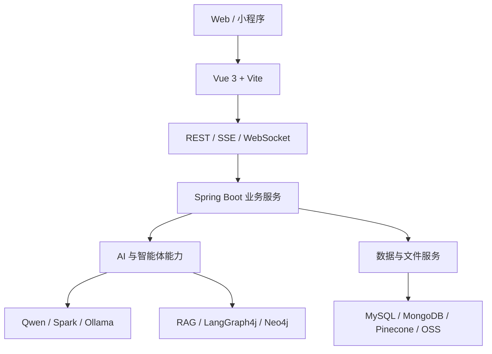

请与作者联系后再拉取代码
# 讯飞学弈

> 基于多智能体协作与自适应调度的智能学习平台

讯飞学弈是一套以“AI 驱动的个性化学习”为核心理念的智能教育平台。平台将大模型对话、RAG 检索增强生成、知识图谱、数字人教师与多智能体课程生成整合到同一学习闭环中，为学习者提供从课程生成、知识学习、练习测评到画像分析与个性化推荐的全链路体验。

平台包含学生端与管理端：学生端聚焦学习、交互与能力提升，管理端负责用户、资源与运营数据管理。


## 目录

- [核心能力](#核心能力)
- [系统架构](#系统架构)
- [技术栈](#技术栈)
- [环境要求](#环境要求)
- [快速开始](#快速开始)
- [构建与测试](#构建与测试)
- [主要模块](#主要模块)
- [接口约定](#接口约定)
- [部署](#部署)
- [安全与配置提示](#安全与配置提示)

## 核心能力

- **AI 智能对话**：支持文本、图片和文档输入，提供多轮记忆与 SSE 流式响应；纯文本由通义千问处理，多模态内容由讯飞星火处理。
- **AI 课程生成**：从自然语言中提取主题、难度、周期和教学风格，自动生成课程大纲、章节内容、随堂练习与考试题。
- **多智能体协作**：基于 LangGraph4j 编排画像分析、需求提取、任务调度、资源收集、交叉审核和内容交付 6 类 Agent，并通过 SSE 推送执行进度。
- **企业级 RAG**：支持文档上传、自动向量化、知识库问答和引用溯源，内置查询改写、HyDE、向量检索、权限过滤、重排序、引用生成、上下文格式化 7 阶段流水线。
- **知识图谱**：使用 Neo4j 存储知识点及其关系，支持自然语言生成 Cypher、查询校验与图谱可视化。
- **个性化学习路线**：结合专业方向、学习目标、知识基础和认知风格生成学习路线，并补充视频资源。
- **在线考试**：支持课程考试与小节测试、自动保存、服务端权威计时、超时自动提交，以及单选、多选、判断和填空题自动判分。
- **学生画像**：融合引导对话、学习时长、工具使用、课程完成度和测评结果，持续更新知识基础、认知风格、资源偏好与薄弱知识点。
- **数字人教师**：集成讯飞数字人 Web SDK，支持 3D 渲染、WebRTC、ASR 语音输入、TTS 播报与口型同步。
- **AI 内容查证**：提取事实性声明，联网检索证据并由大模型进行语义比对，生成带可信度评分的验证报告。
- **学习资源与内容生产**：支持资源搜索与收藏、PPT 生成、思维导图生成和多格式文件解析。
- **会员积分与支付**：使用 AOP 统一完成 AI 功能调用前的积分校验与扣减，记录完整流水，并支持支付宝充值。

## 学习闭环



## 系统架构

系统采用前后端分离的 B/S 架构。前端基于 Vue 3 与 Vite，后端由 Spring Boot 3.2.10 提供 RESTful API，并通过 SSE、WebFlux 和 WebSocket 支撑流式对话、工作流进度和数字人交互。



### 数据存储分工

| 存储 | 用途 | 是否必需 |
| --- | --- | --- |
| MySQL 8.0+ | 用户、课程、题目、画像、积分、订单等结构化业务数据 | 是 |
| MongoDB 4.x+ | AI 对话历史与会话记忆 | 是 |
| Neo4j 5.x+ | 知识图谱节点、关系与 Cypher 查询 | 使用图谱功能时需要 |
| Pinecone | 文档 Embedding 与语义检索 | 使用 RAG 功能时需要 |
| 阿里云 OSS | 图片、文档等非结构化文件 | 使用云端文件存储时需要 |
| Caffeine | Embedding 等短期本地缓存 | 已集成 |

> 当前项目未实际接入 Redis，缓存主要依赖 Caffeine、MongoDB TTL 索引及数据库直接查询。

## 技术栈

### 后端

| 技术 | 版本 / 说明 |
| --- | --- |
| Java | JDK 17 |
| Spring Boot | 3.2.10 |
| MyBatis Spring Boot Starter | 3.0.4 |
| LangChain4j | 1.0.0-beta4 |
| LangGraph4j | 1.8.6 |
| Spring WebFlux | AI 流式响应 |
| Spring Data MongoDB / Neo4j | 会话记忆与知识图谱 |
| Apache POI / PDFBox | Office 与 PDF 文档解析 |
| MySQL Connector/J | 8.0.31 |
| Alipay SDK | 4.35.79.ALL |

### 前端

| 技术 | 版本 / 说明 |
| --- | --- |
| Vue | 3.4.29 |
| Vite | 5.3.1 |
| Vue Router | 4.4.3，History 模式 |
| Pinia | 2.2.2 |
| Element Plus | 2.8.4 |
| ECharts / Chart.js | 数据可视化 |
| Mermaid / Vue Flow | 图表与工作流展示 |
| Axios | 1.7.5 |
| Tailwind CSS | 4.2.2 |

### AI 模型

| 场景 | 默认模型 / 服务 |
| --- | --- |
| 文本对话与生成 | 通义千问 `qwen-plus` |
| 向量化 | DashScope `text-embedding-v3` |
| 图片理解与多模态 | 讯飞星火 `generalv3.5` |
| 本地对话 | Ollama `qwen3:8b` |
| 本地向量化 | Ollama `mxbai-embed-large:latest` |
| RAG 重排序 | SiliconFlow `BAAI/bge-reranker-v2-m3` |

## 环境要求

建议开发环境至少为 4 核 CPU、8 GB 内存和 50 GB 可用磁盘空间；推荐使用 8 核以上 CPU、16 GB 以上内存及 SSD。

| 软件 | 要求 |
| --- | --- |
| JDK | 17+ |
| Node.js | 开发环境建议 22.19.0；运行前端至少 18+ |
| npm | 随 Node.js 安装 |
| Maven | 3.x+ |
| MySQL | 8.0+ |
| MongoDB | 4.x+ |
| Neo4j | 5.x+，可选 |
| Ollama | 最新版，可选 |

默认服务地址：

| 服务 | 地址 / 端口 |
| --- | --- |
| 后端 API | `http://localhost:9000` |
| 前端开发服务器 | `http://localhost:5173` |
| MongoDB | `localhost:27017/chat_memory_db` |
| Neo4j | `127.0.0.1:7687` |
| Ollama | `127.0.0.1:11434` |

## 快速开始

### 1. 获取代码

克隆或下载项目源码，并进入包含后端 `pom.xml` 的工程根目录。

### 2. 准备基础服务

启动 MySQL 和 MongoDB，并创建项目所需数据库。若需要知识图谱、本地模型或 RAG 能力，还需分别准备 Neo4j、Ollama 与 Pinecone。

### 3. 配置环境变量

按需设置下列变量。请勿将真实密钥提交到 Git 仓库。

```bash
export MYSQL_PASSWORD="your-mysql-password"
export DASHSCOPE_API_KEY="your-dashscope-api-key"
export SPARK_APP_ID="your-spark-app-id"
export SPARK_API_KEY="your-spark-api-key"
export SPARK_API_SECRET="your-spark-api-secret"

# 可选功能
export PPT_API_SECRET="your-ppt-api-secret"
export PINECONE_API_KEY="your-pinecone-api-key"
export RERANK_API_KEY="your-rerank-api-key"
export ALIOSS_ACCESS_KEY_ID="your-oss-access-key-id"
export ALIOSS_ACCESS_KEY_SECRET="your-oss-access-key-secret"
export ALIPAY_PRIVATE_KEY="your-alipay-private-key"
export ALIPAY_PUBLIC_KEY="your-alipay-public-key"
export ALIPAY_NOTIFY_URL="https://your-domain.example/alipay/notify"
```

同时检查 `application.yaml` 中的数据库连接、CORS、文件目录、模型服务和第三方回调配置。生产环境不要使用示例值或默认凭据。

### 4. 启动后端

```bash
mvn spring-boot:run -DskipTests
```

也可以在 IDE 中运行 `ProjectManagement.main()`。后端默认监听 `9000` 端口。

### 5. 启动前端

```bash
cd web
npm install
npm run dev
```

浏览器访问 `http://localhost:5173`。前端通过 Vite Proxy 或 Nginx 将 API 请求转发到后端 `9000` 端口。

## 构建与测试

运行后端测试：

```bash
mvn test
```

构建后端 JAR：

```bash
mvn clean package
```

后端构建产物为可独立运行的 Spring Boot JAR，项目说明书中的最终文件名为 `template.jar`。

构建前端：

```bash
cd web
npm run build
```

前端静态资源输出到 `web/dist`。

## 主要模块

| 模块 | 主要职责 |
| --- | --- |
| 用户认证 | 学生与管理员注册、登录、JWT 鉴权和个人信息管理 |
| AI 对话 | 多模态输入、流式输出、会话管理与 MongoDB 持久化记忆 |
| 课程管理 | 课程、章节、小节三级内容管理与学习进度追踪 |
| AI 课程生成 | 参数提取、大纲生成、内容生成、练习生成与内容查证 |
| 多智能体工作流 | 6 类 Agent 协作、人工审核节点、执行追踪与资源交付 |
| PPT / 思维导图 | 基于课程或自由主题生成教学课件与知识导图 |
| 知识库与 RAG | 文档解析、异步向量化、检索增强问答和引用溯源 |
| 知识图谱 | 图谱构建、自然语言转 Cypher、校验执行与可视化 |
| 学习路线 / 学生画像 | 个性化路线、资源匹配、多维学习画像与动态更新 |
| 在线考试 | 会话管理、自动保存、服务端计时、自动提交与判题 |
| 数字人教师 | 3D 虚拟教师、语音交互、课程上下文与实时播报 |
| 积分与支付 | 积分账户、消耗规则、交易流水与支付宝充值 |
| 管理后台 | 用户、课程、AI 用量、学习时长和学习效果统计 |

## 接口约定

除流式接口外，Controller 统一使用以下响应结构：

```json
{
  "code": 200,
  "message": "操作成功",
  "data": {}
}
```

登录入口为 `POST /common/login`，通过 `type` 区分 `STUDENT` 与 `ADMIN`。认证成功后，请在后续请求中携带服务端签发的 JWT。

开放路径包括登录、注册、找回密码、文件访问及支付宝回调；其余接口默认由登录拦截器进行鉴权。AI 对话、知识库问答、多智能体工作流和数字人对话分别使用 WebFlux SSE 或 `SseEmitter` 返回实时数据。

## RAG 流水线


流水线提供默认、快速和高质量三种预设模式。各阶段可独立开关、计时和降级，单个增强环节失败时不阻断整体问答。

## 部署

推荐使用 Linux、JDK 17、MySQL 8.0、MongoDB 5.0+ 与 Nginx。生产部署的基本流程如下：

1. 使用 `npm run build` 生成前端 `dist`。
2. 使用 `mvn clean package` 构建后端 JAR。
3. 通过 `java -jar template.jar` 启动后端。
4. 让 Nginx 托管前端静态资源，并将 `/api/*` 反向代理到 `http://localhost:9000/`。
5. 为 Vue History 路由配置 `try_files $uri $uri/ /index.html`。
6. 为数字人 WebRTC/WebSocket 通信配置连接升级请求头，并启用 HTTPS。

生产环境必须修改 CORS 白名单、数据库地址、OSS/CDN 域名及支付宝回调地址。

## 安全与配置提示

- 所有 API Key、数据库密码、支付私钥及 OSS 凭据必须通过环境变量或专用密钥管理服务注入。
- 项目说明书指出，当前用户密码校验仍存在明文比对实现；部署到生产环境前应完成 BCrypt/Argon2 哈希迁移，并制定旧密码升级策略。
- 支付宝回调必须校验签名、金额、商户订单号及幂等状态。
- 自然语言生成的 Cypher 必须经过只读限制、语法校验和访问控制后才能执行。
- 文件上传应限制大小、扩展名与 MIME 类型，并对可执行内容进行隔离。
- 当前积分机制为调用前扣减；如需严格计费，建议为模型调用失败、超时和重试补充事务补偿或退款机制。

## 浏览器兼容性

推荐 Chrome 90+，同时兼容 Edge 90+、Firefox 88+ 和 Safari 14+。数字人功能依赖 WebRTC，实际兼容性取决于浏览器、设备权限和网络环境。

## 项目成员

- 潘骧骏
- 杜勇超

## License

项目说明书未声明开源许可证。在补充许可证之前，默认保留所有权利；如需公开发布或允许复用，请在仓库中添加明确的 `LICENSE` 文件。
